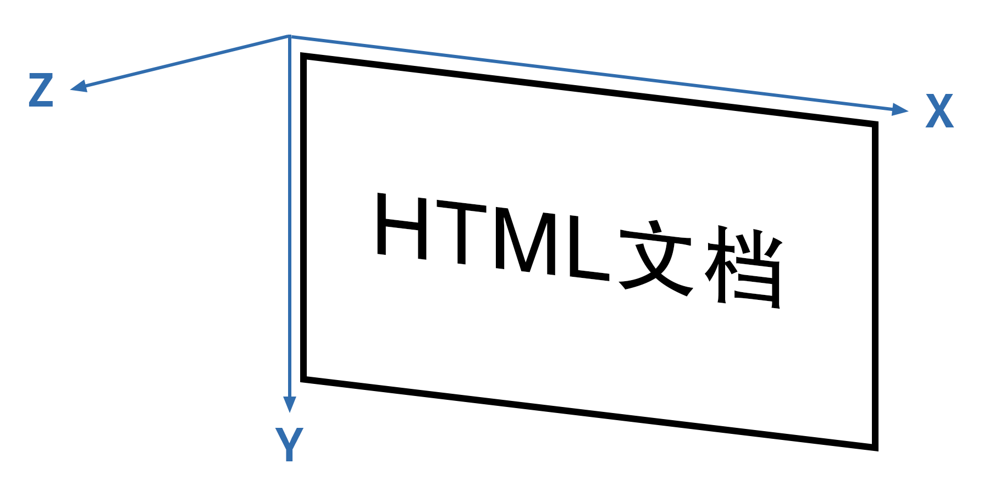

# CSS学习——动画

动画是 CSS 的核心功能之一，它使网页能够展现更多生动、丰富的内容。

CSS 动画是 Web 设计艺术的核心内容之一。不过我们设计页面时需要注意动画的适用范围：在展示性的网页和普通应用程序方面，动画可以提升用户的使用体验；而在生产力工具方面，则应当尽量克制地使用 CSS 动画，防止无关动画对工作效率造成影响。

下面是关于 CSS 动画的介绍，让我们开始吧。

## 一、transition 动画

在 CSS 中，许多属性都有可预测的变化（都有**过程**）。例如：

```
opacity:0 → opacity:1;            /*属性内容由 0 逐渐变为 0.1、0.2、0.4 ··· 1.0*/
padding:10px → padding:50px;      /*属性内容由 10px 逐渐变为 20px、30px ··· 50px*/
```

在不定义动画的时候，这些属性的内容是突变的，因而元素的样式是瞬时变化的，表现得比较突兀。但是，如果我们利用这些属性的内容的变化过程，将内容的变化从突变变成逐渐变化，就能够使样式的变化变得平缓——这就是 CSS **动画**。

实现 CSS 动画的最简单方法是 transition，它会根据属性内容的变化，自动计算出相应的 CSS 动画，在定义简单动画时非常简便。

### （一）基础属性

transition 属性的语法如下：

```css
transition:<动画属性1> <时间> <变化曲线> <延时>,<动画属性2> <时间> <变化曲线> <延时> ····;
```

多个动画间以 “ , ” 分隔。例如：

```
.button {
  background-color:white;
  color:black;
  transition:background-color .15s,color .15s;
  &:hover {
    background-color:blue;
    color:white;
  }
}
```

我们暂时缺省第三、四个属性（变化曲线和延时）。在这里，我们为 button 加上了背景颜色和文本颜色的过渡，使背景色逐渐由白变蓝、文本色由黑变白，动画时间均为 0\.15s。

注意不能写多个 transition，否则后面的会全部覆盖前面的。例如：

```
.text {
  transition:color .15s,background-color .15s;
  transition:padding .15s;
}
```

最后只会剩下 padding 的 0\.15s 动画。

transition 只对可插值属性生效，对 display、height: auto 无效。

### （二）变化曲线和延时

变化曲线决定了属性的内容是如何变化的，默认是 ease（刚开始缓慢变化，中间加快，最后又变慢）。

#### 1、几种预设曲线

可以使用关键字来调用一些预设曲线，例如：

- —— linear（线性）：匀速变化，全程变化速度不变。
- —— ease\-in：慢进快出。
- —— ease\-out：快进慢出。
- —— ease\-in\-out：两端慢、中间快。

```
.button {
  transition:color .15s ease-in-out;
}
```

总之，ease\-\* 系列关键字，决定了动画是否在开始/结束时 “缓入缓出”。

注意：ease\-in\-out 和 ease 均为淡入淡出，但 ease\-in\-out 是对称的（初/末速度均为0），更加平滑；ease 是非对称的（初速度不为0）。

#### 2、贝塞尔曲线

如果使用关键字定义仍然不能满足动画需要，则可以使用 **贝塞尔曲线** cubic\-bezier 自定义动画曲线。

例如：

```
.button {
  transition:background-color .15s cubic-bezier(0.29, 1.01, 1, -0.68);
}
```

现在的前端 IDE 大部分都已经有很直观的贝塞尔曲线编辑器，无需背记相关规则。

#### 3、延时（delay）

第四个属性是延时，它决定了动画在播放前的 “耽搁”。例如，延时被设置为 0\.4s 时，当动画被触发时，浏览器会等待 0\.4s 才执行实际的动画操作。

## 二、transform 变换

transform 规定了元素的几何变换（移动、旋转、缩放等），我们可以使用 transform 属性的变化，配合 CSS 动画语法使用，制作出几何方面的 CSS 动画。

### （一）坐标系和变换原点

#### 1、初始坐标系

在 transform 变换中，采取如下坐标系：

- —— X 轴：平行于底部，从左指向右。
- —— Y 轴：平行于左部，从上指向下。
- —— Z 轴：垂直于屏幕面，由屏幕内指向屏幕外。

{width=500px}

#### 2、原点 —— transform\-origin

可使用 transform\-origin 属性来设置 transform 变化的原点。基本用法如下：

```
transform-origin: <X> <Y> <Z>
```

三个坐标参数可以是像素，X、Y轴参数也可以是百分数、关键字（left、right、center），用于设置变换原点的位置。如果不是 3D 变化，可以缺省 <Z\>。

例如：

```
transform-origin: center center;  /* 默认，元素中心 */
transform-origin: left top;       /* 左上角 */
transform-origin: 0 0;            /* 左上角，坐标写法 */
transform-origin: 50% 100%;       /* 底部中心 */

```

注意：transform\-origin 的坐标系和上面说的坐标系是一样的，但是 top、bottom 等关键字是 “形态学位置”，因此 top 永远指代的是屏幕的上部，它指代的并不是 Y 最大、而是 Y 最小的地方。例如，下面的写法是等价的：

```
transform-origin: right top;
transform-origin: 100% 0%;
```

### （二）transform 基本用法

#### 1、基础用法

transform 的用法如下：

```
transform: <act1> <act2> ·····;
```

例如：

```
transform:rotateX(90deg) translateX(20px);
```

注意，多个动作之间以空格而非逗号分隔。另外，transform 属性会互相覆盖，一个 CSS 块中不能写两个 transform。例如，上面的属性不能拆为下面的写法：

```
transform:rotateX(90deg);
transform:translateX(20px);
```

下面的 transform 属性会覆盖上面的，导致最后只剩下下面的动作。

#### 2、多动作关系

执行动作时，浏览器按从左到右的顺序执行。因此，下面两种写法是不同的：

```
transform:translateX(-50px) rotateZ(30deg);
transform:rotateZ(30deg) translateX(-50px);
```

前者是先平移后旋转，后者是先旋转后平移。

为什么会这样呢？因为元素的动作是以自身的局部坐标系来执行的。元素的初始局部坐标系为初始坐标系，而变换会使元素的坐标系发生改变（例如，rotateZ\(30deg\) 后 X 轴也会以 Z 轴为轴顺时针旋转 30 度），导致 translateX 等的实际语义改变，产生意料之外的效果。

#### 3、配合 transition

可配合 transition 实现 transform 的变换：

```
.button {
  transition:transform .15s;
}
.button:hover {
  transform:translateX(20px);
}
```

button 被 hover 后会出现 X 轴方向 0\.15s 的 20px 平滑滑动。

注意：transition 中属性写为 transform，不写具体动作。

#### 4、其他参数

可用 backface\-visibility 属性控制 3D 变换时是否显示元素的背面。

```css
backface-visibility: hidden;        /* 隐藏 */
backface-visibility: visible;       /* 显示 */
```

在做翻转卡片时，可通过 hidden 实现卡片的隐藏效果；普通 3D 则可使用 visible。默认为 visible。

### （三）常见的 transform 变换

transform 变化对元素位置的改变有些类似 position:relative —— 元素的实际位置并未改变（未脱离原有文档流），但视觉位置发生了改变。

#### 1、平移（translate）

将元素平移一定的距离。平移语法有四种：

```
translateX(<x>);
translateY(<y>);
translateZ(<z>);
translate(<x>,<y>);
```

可使元素分别沿着 X、Y、Z 轴方向平移。

第四种语法是合并语法，可同时使元素沿着 X、Y 方向移动。其中 Y 的内容可以缺省（默认为 0）。

#### 2、旋转（rotate）

使元素旋转一定的角度（正数为顺时针旋转）。旋转语法也有三种：

```css
rotateX(<angle>);
rotateY(<angle>);
rotateZ(<angle>);

```

角度需要带上单位，例如 deg、rad、turn（圆周）、grad 等。

此外，还有综合写法 rotate3d：

```
rotate3d(<x>,<y>,<z>,<angle>);
```

它的意思是：以空间向量（x,y,z）为旋转轴旋转一定角度。例如：

```
.card {
  transform:rotate3d(1,1,0,30deg)
}
```

意味着以空间向量 \(1,1,0\) 为旋转轴旋转 30 度。

此外还有一个最简写法 rotate\(<angle\>\)，它等价于 rotateZ\(<angle\>\)，更加简洁。

#### 3、缩放（scale）

和上面基本一致，但 scale 接受的参数必须是百分类数（如 50%、0\.5），不能写 50px 等。

scale 有一种合并语法，是：

```
scale(<sx>,<sy>);
```

意味着分别沿着 X、Y 轴方向缩放。

## 三、animation 关键帧（keyframes）动画

transition 动画已经可以解决一些基本的动画问题，但它本质上是对 CSS 属性内容的 “初→末” 变化作插帧平滑处理。如果我们想要精确控制整个 CSS 样式变化的过程（例如，指定动画播放30%时rotateZ程度为50deg），而不仅仅是根据 CSS 初/末样式自动生成简单的过程动画，就需要引入 keyframes **关键帧动画**。

### （一）关键帧动画

#### 1、声明方法

关键帧动画需要使用 @keyframes（注意是**复数**）规则声明。语法如下：

```css
@keyframes <动画名> {
  百分进度 {
    
  }
  ······
}
```

例如：

```css
@keyframes iconUpDown {
  0% {
    transform:translateY(0px);
  }
  40% {
    transform:translateY(-10px);
  }
  80% {
    transform:translateY(5px);
  }
  100% {
    transform:translateY(0px);
  }
}
```

可使用 from、to 关键字来表示 0%、100%，其作用完全相同。

注意：transition 和 animation 相同，均不支持离散属性的过渡（如 display:none）。另外，如果一个元素的 display 为 none，则其动画不会被播放，只有 display 不再为 none 时才会开始播放。

#### 2、调用方法

可使用 animation 参数引入 keyframes 动画。animation 基本语法和 transition 很像，为：

```
.diva {
  animation:<名字> <持续时间> <变化曲线> <延迟时间>,······;
}
```

例如：

```
.icon {
  animation:iconUpDown .15s ease-in-out .15s;
}
```

这里的 ease\-in\-out（淡入淡出）关键字（或贝塞尔曲线）和 transition 语法一致，但效果有区别：它会作用于所有关键帧之间。例如：

```
@keyframes slide {
  0%   { transform: translateX(0); }
  50%  { transform: translateX(100px); }
  100% { transform: translateX(0); }
}
.box {
  animation: slide 1s ease-in-out;
}
```

由于 50% 时速度为0，ease\-in\-out 又使动画在 50% 时缓入缓出，因此视觉上 50% 时看起来会像是暂时停住了。

### （二）进阶参数

其实 animation 的完整语法如下：

```css
animation:<名字> <持续时间> <变化曲线> <延迟时间> <次数> <方向> <填充模式> <状态>;
```

后四个属性是可缺省的高级属性。由于它们的关键字、写法等都完全不同，因此可以任意缺省，浏览器能够识别我们写的是哪个属性。

#### 1、次数 animation\-iteration\-count

决定了动画的播放次数，默认为 1。

次数可以是小数，例如 2\.5（播放2\.5次，第三次播放只播放一半）；也可以使用关键字 infinite（无限），使动画循环播放。

#### 2、方向 animation\-direction

决定了动画的播放方向（如 100% =\> 0%）。其几个取值为：


- —— normal：默认值，0 =\> 100%。
- —— reverse：反转，100% =\> 0%（倒过来播放动画）。
- —— alternate：交替，奇数次播放为 normal，偶数次播放为 reverse。
- —— alternate\-reverse：反转交替，交替的播放行为反过来。


#### 3、填充模式 animation\-fill\-mode

决定了动画开始前、结束后，元素是否仍然具有动画所规定的一些属性。几种取值如下：


- —— none：默认值，不保留动画效果。动画结束后，元素将瞬间变回动画播放前的样式；当有 delay 播放时，delay 时间内元素保持动画播放前的样式。
- —— forwards：向前。动画结束后，元素的样式将保持在最后一帧
- —— backwards：向后。动画开始但仍然处于 delay 中时，将动画的第一帧作为元素的样式，直到动画开始。
- —— both：同时具有 forwards、backwards 属性。


#### 4、状态 animation\-play\-state

这一属性有两个内容，分别是 running、paused（运行中、停止）。若播放中的动画被赋予 animation\-play\-state:paused，则动画会暂停。这一属性可用于精细控制动画。

### （三）综合示例

```
.leftbar {
  position:fixed;
  width:50px;
  height:50px;
  background-color:blue;
  animation:anim 1s linear <delay缺省> infinite normal both;
}
.leftbar:hover {
  animation-play-state:paused;
}
@keyframes anim {
  to {
    transform:rotate(360deg);
  }
}
```